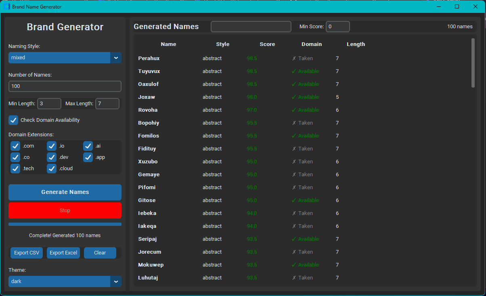

<h2 align="center">Brand Engine - AI-Powered Brand Name Generator</h2>
<p align="center">
	
</p>
A sophisticated brand name generator with domain availability checking, scoring, and export capabilities.

## Features
-  **Modern GUI** - Built with CustomTkinter for a polished look
-  **Smart Generation** - Multiple naming styles (compound, abstract, animal, nature)
-  **Domain Checking** - Real-time WHOIS/RDAP domain availability
-  **Intelligent Scoring** - Scores names based on phonetics, memorability, and brand appeal
- **Similarity Filtering** - Removes duplicate and similar names
-  **Database Storage** - SQLite database for persistence
-  **Export Options** - CSV, JSON, and Excel export
-  **Multi-threaded** - Fast generation without UI freezing
- **Live Filtering** - Search and filter results in real-time

## Installation
> [!IMPORTANT]
> If you prefer not to customize the repository files, you can simply download the standalone bundled executable file for BrandEngine [here](https://github.com/yavotu/BrandEngine/releases).


1. Clone/download Zip of the repository:
```bash
git clone https://github.com/Lewismwaz/BrandEngine.git
cd BrandEngine
```

2. Create icon for BrandEngine executable file.
- Open PowerShell from `\BrandEngine`:
- If Pillow isn't installed, run:
```powershell
python -m pip install Pillow
```
- Then run:
```powershell
python -c "from PIL import Image; img = Image.open('assets/logo.png').convert('RGBA'); img.save('assets/icon.ico', sizes=[(256,256),(128,128),(64,64),(48,48),(32,32),(16,16)])"
```

Verify it worked:
```powershell
Get-Item assets\icon.ico | Select-Object Name, Length
```


3. Ensure you have latest `pip` and Python 3.10+ installed, and both are added to PATH, then double click to open the `build.bat` or well known as `build` Windows Batch File and let it install all the required Python dependencies and also generate the executable file.


5. Locate the exe file `dist\BrandEngine.exe` and open it.

## User Interface





## License
This project is licensed under the GPL License. View License [here](https://github.com/Lewismwaz/BrandEngine/blob/main/LICENSE).  
More details about the License can be found [here.](https://choosealicense.com/licenses/gpl-3.0/)

## Contact
For any inquiries, please contact:
- Email - <eappointmaster@gmail.com> or <yavotu@gmail.com>
- GitHub - [@Lewismwaz](https://github.com/Lewismwaz) or [@Yavotu](https://github.com/Yavotu)

[Brand Engine](https://github.com/Lewismwaz/BrandEngine) **©** 2026, All Rights Reserved
