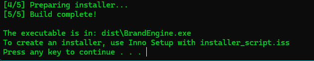

# Brand Engine - AI-Powered Brand Name Generator

A sophisticated brand name generator with domain availability checking, scoring, and export capabilities.

## Features
-  **Modern GUI** - Built with CustomTkinter for a polished look
-  **Smart Generation** - Multiple naming styles (compound, abstract, animal, nature)
-  **Domain Checking** - Real-time WHOIS/RDAP domain availability
-  **Intelligent Scoring** - Scores names based on phonetics, memorability, and brand appeal
- **Similarity Filtering** - Removes duplicate and similar names
-  **Database Storage** - SQLite database for persistence
-  **Export Options** - CSV, JSON, and Excel export
-  **Multi-threaded** - Fast generation without UI freezing
- **Live Filtering** - Search and filter results in real-time

## Installation
1. Clone the repository:
```bash
git clone https://github.com/Lewismwaz/BrandEngine.git
cd BrandEngine
```

2. Ensure you have Python 3.10+ installed and added to PATH then double click to open the `build.bat` or well known as `build` Windows Batch File and let it install all the required Python dependencies and also generate the executable file.


3. Locate the exe file `dist\BrandEngine.exe` and open it.

### UI
